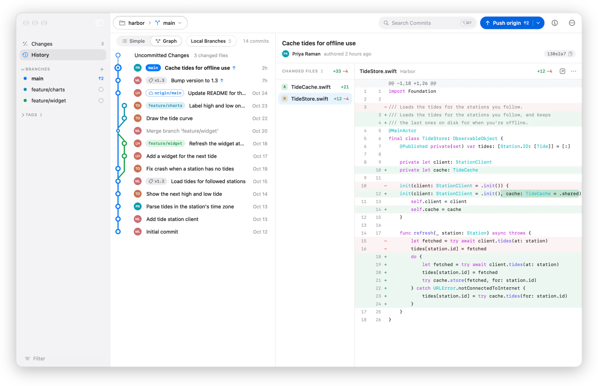
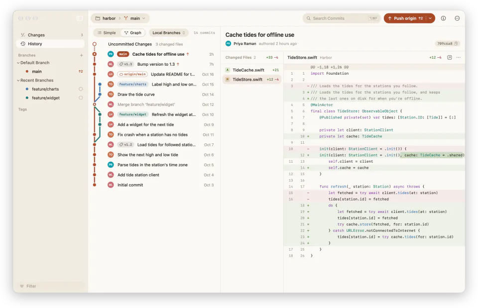
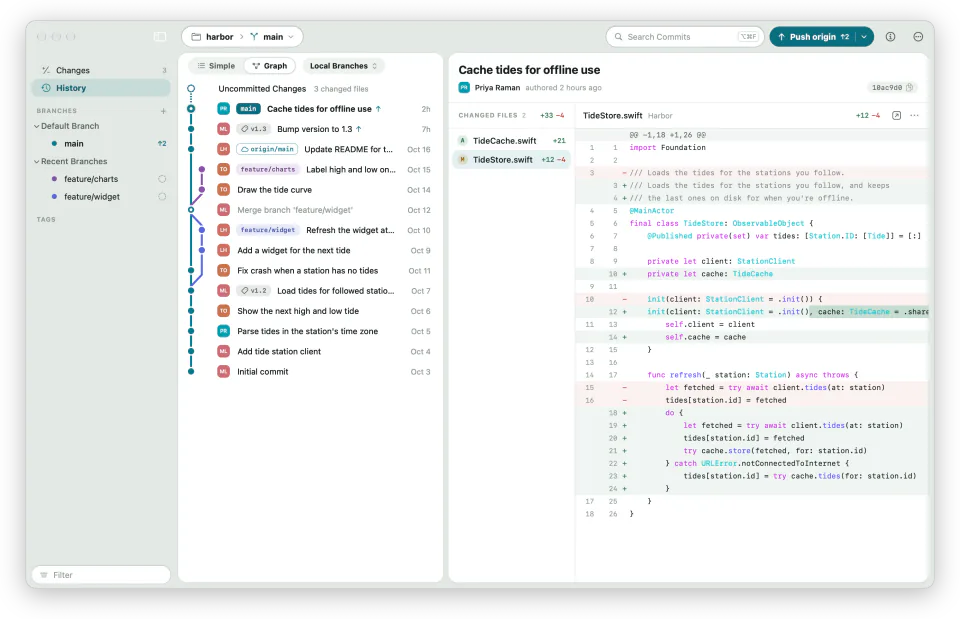
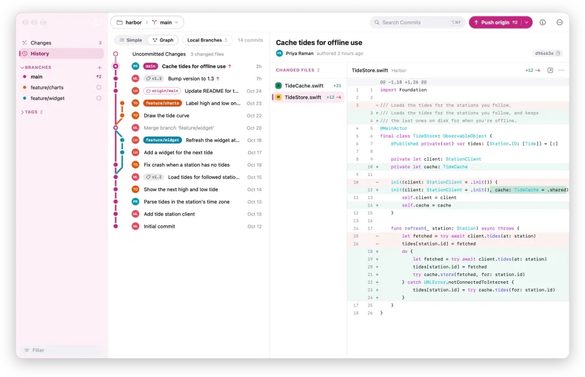

<p align="center">
  <picture>
    <source media="(prefers-color-scheme: dark)" srcset=".github/readme/icon-dark.webp">
    
  </picture>
</p>

<h1 align="center">Espalier</h1>

<p align="center">
  A Git client for the Mac. See every branch as it grew, commit exactly the
  lines you mean, and rework history by dragging commits where they belong.
</p>

<p align="center">
  <a href="https://espalier.abdeen.dev/download"><b>Download for Mac</b></a>
  &nbsp;&middot;&nbsp;
  <a href="https://espalier.abdeen.dev">Website</a>
  &nbsp;&middot;&nbsp;
  <a href="CHANGELOG.md">What's New</a>
</p>

<p align="center"><sub>macOS 27 or later on Apple silicon. Free and open source.</sub></p>

<p align="center">
  <picture>
    <source media="(prefers-color-scheme: dark)" srcset=".github/readme/classic-dark.webp">
    
  </picture>
</p>

## Features

- **Every branch, in view.** The graph draws each line of work in its own
  color, so merges and open branches read at a glance. Switch to Simple for
  just your branch, search every commit, or jump to one by its SHA.
- **Commit the lines you mean.** Include whole files, one hunk, or single
  lines, right in the diff. Read changes unified or side by side, with syntax
  colors for more than 20 languages, and compare images four ways.
- **Rework history by dragging.** Squash, reorder, and cherry-pick by dragging
  commits, without an interactive rebase. Espalier checks for conflicts before
  it starts, and Undo takes it back.
- **Pull requests, beside your branches.** Sign in to GitHub.com or GitHub
  Enterprise to see your open pull requests in the sidebar, follow their
  checks, and get a notification when a review arrives or a check fails.
- **AI, with your own keys.** Write commit messages and work through merge
  conflicts with OpenAI, Anthropic, Azure OpenAI, or a model running on your
  Mac. Your keys stay in your Keychain.
- **Make it yours.** Four themes, each with its own colors, plus background
  tints, a choice of fonts, and light or dark to match your Mac.

<p align="center">
  <picture>
    <source media="(prefers-color-scheme: dark)" srcset=".github/readme/orchard-dark.webp">
    
  </picture>
  <picture>
    <source media="(prefers-color-scheme: dark)" srcset=".github/readme/islands-dark.webp">
    
  </picture>
  <picture>
    <source media="(prefers-color-scheme: dark)" srcset=".github/readme/pop-dark.webp">
    
  </picture>
</p>

<p align="center"><sub>Orchard, Islands, and Pop</sub></p>

## Building

Building Espalier takes Xcode 27. Espalier bundles its own copy of Git (with
Git LFS and Git Credential Manager) from desktop's
[dugite-native](https://github.com/desktop/dugite-native) releases. Install
the pinned build once:

```bash
scripts/fetch-git.sh
```

Then build the app in Xcode with the `Espalier` scheme, or from the command line:

```bash
xcodebuild -project Espalier.xcodeproj -scheme Espalier -configuration Debug -derivedDataPath DerivedData build
```

Run the tests from the package:

```bash
cd Packages/EspalierKit && swift test
```

## Credits

Espalier began as a port of [GitHub Desktop](https://github.com/desktop/desktop),
which is released under the MIT license, copyright GitHub, Inc. Desktop's test
suite and fixture repositories are the basis of many of Espalier's tests. The
bundled Git comes from [dugite-native](https://github.com/desktop/dugite-native).

Espalier is an independent project. It is not affiliated with, endorsed by, or
sponsored by GitHub, Inc. GitHub is a trademark of GitHub, Inc.

## License

Espalier is released by [Abdeen Labs](https://abdeen.dev) under the
[MIT license](LICENSE). Code and data from other projects keep their own
licenses, listed in [LICENSE-THIRD-PARTY](LICENSE-THIRD-PARTY).
