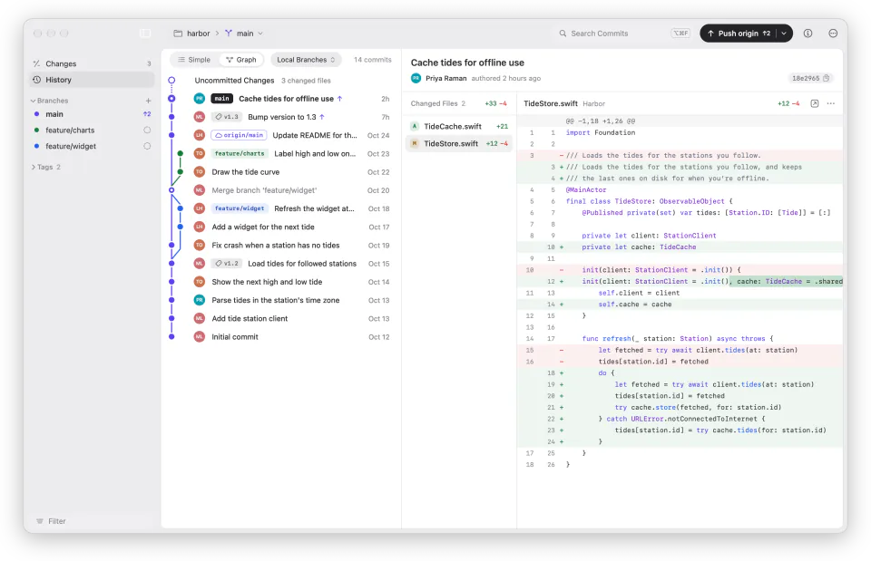

<p align="center">
  <picture>
    <source media="(prefers-color-scheme: dark)" srcset=".github/readme/icon-dark.webp">
    
  </picture>
</p>

<h1 align="center">Espalier</h1>

<p align="center">
  A native Git client for the Mac, written in Swift. Keep track of your
  branches, stage individual lines, and clean up commits before you push.
</p>

<p align="center">
  <a href="https://espalier.abdeen.dev/download"><b>Download for Mac</b></a>
  &nbsp;&middot;&nbsp;
  <a href="https://espalier.abdeen.dev">Website</a>
  &nbsp;&middot;&nbsp;
  <a href="CHANGELOG.md">What's New</a>
</p>

<p align="center"><sub>Requires macOS 27 or later on Apple silicon. Free and MIT-licensed.</sub></p>

<p align="center">
  <picture>
    <source media="(prefers-color-scheme: dark)" srcset=".github/readme/classic-dark.webp">
    
  </picture>
</p>

## Features

- **Readable commit history.** Graph view draws each branch in its own color
  so merges and open branches are easy to follow, while Simple view gives you
  a plain list of commits. Search across commits, jump to any SHA, or compare
  ahead/behind counts between branches.
- **Line-by-line staging.** Stage whole files, hunks, or individual lines
  right in the diff, and discard changes you don't want. Supports unified and
  split diffs, syntax highlighting for 20+ languages, and four image diff
  modes (2-Up, Swipe, Onion Skin, and Difference).
- **Drag to rework history.** Squash, reorder, and cherry-pick commits by
  dragging them—no interactive rebase required. Espalier checks for conflicts
  before starting, tracks progress, and lets you Undo (⌘Z).
- **GitHub integration.** Sign in to GitHub.com or GitHub Enterprise to view
  open pull requests in the sidebar, check them out, monitor or re-run CI
  checks, and inspect push-protection secret blocks.
- **Bring-your-own-key AI.** Draft commit messages and resolve merge conflicts
  using OpenAI, Anthropic, Azure OpenAI, or a local model on your Mac. API
  keys stay in your Keychain, and nothing is sent unless you configure a
  provider.
- **Customizable interface.** Choose from four themes (Classic, Frost,
  Islands, and Pop), tweak background tints, pick your UI and code fonts, and
  match your Mac's light or dark appearance.

<p align="center">
  <picture>
    <source media="(prefers-color-scheme: dark)" srcset=".github/readme/frost-dark.webp">
    
  </picture>
  <picture>
    <source media="(prefers-color-scheme: dark)" srcset=".github/readme/islands-dark.webp">
    
  </picture>
  <picture>
    <source media="(prefers-color-scheme: dark)" srcset=".github/readme/pop-dark.webp">
    
  </picture>
</p>

<p align="center"><sub>The Frost, Islands, and Pop themes</sub></p>

## Building

Building Espalier takes Xcode 27. Espalier bundles its own copy of Git (with
Git LFS and Git Credential Manager) from desktop's
[dugite-native](https://github.com/desktop/dugite-native) releases. Install
the pinned build once:

```bash
scripts/fetch-git.sh
```

Then build the app in Xcode with the `Espalier` scheme, or from the command line:

```bash
xcodebuild -project Espalier.xcodeproj -scheme Espalier -configuration Debug -derivedDataPath DerivedData build
```

Run the tests from the package:

```bash
cd Packages/EspalierKit && swift test
```

## Credits

Espalier began as a port of [GitHub Desktop](https://github.com/desktop/desktop),
which is released under the MIT license, copyright GitHub, Inc. Desktop's test
suite and fixture repositories are the basis of many of Espalier's tests. The
bundled Git comes from [dugite-native](https://github.com/desktop/dugite-native).

Espalier is an independent project. It is not affiliated with, endorsed by, or
sponsored by GitHub, Inc. GitHub is a trademark of GitHub, Inc.

## License

Espalier is released by [Abdeen Labs](https://abdeen.dev) under the
[MIT license](LICENSE). Code and data from other projects keep their own
licenses, listed in [LICENSE-THIRD-PARTY](LICENSE-THIRD-PARTY).
